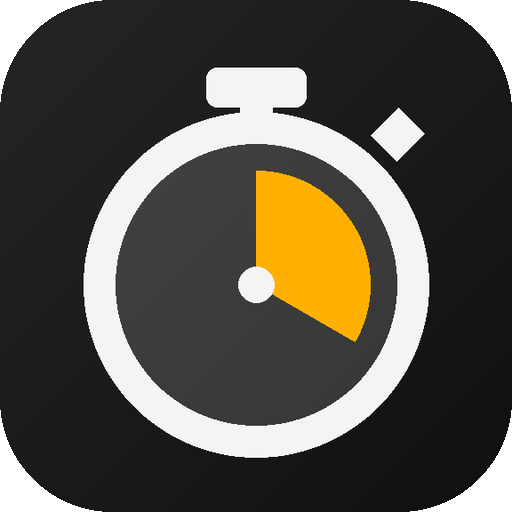

<div align="center">



# Time2Timelapse

**Android için hızlandırılmış çekim kamerası.**
Saatlerce, haftalarca çek; zaman eşit aksın. İsteğe bağlı Google Drive yedeğiyle diğer cihazlarından izle.

[**🌐 Website**](https://sehapps.github.io/time2timelapse/) ·
[**▶️ Google Play**](https://play.google.com/store/apps/details?id=com.sehapps.time2timelapse) ·
[🇹🇷 Türkçe](https://sehapps.github.io/time2timelapse/tr/)

</div>

---

## Uygulama hakkında

Time2Timelapse, telefonunu uzun süreli bir hızlandırılmış çekim kamerasına çevirir. Kareler cihazda çekilir ve
videoya orada dönüştürülür; hesap ve reklam yoktur.

- **Zaman eşit akar** — her kare çekildiği ana göre yerleşir; kesintiler videoda kısa siyah bir geçişle görünür
- **Pozlama kilitli** — parlaklık ve beyaz dengesi kayıt boyunca titremez
- **Uzun kayıtlar** — saatlik parçalar, düşük pil / depolama / sıcaklık uyarıları, zamanlanmış başlatma
- **İsteğe bağlı yedek** — parçalar çekildikçe kendi Google Drive'ında bu uygulamaya ayrılmış alana yüklenir
- **Diğer cihazlarından izle** — kameranın durumu, zaman çizelgesi, aralık seçip dışa aktarma, çöp kutusu

## Gizlilik

Geliştiricinin sunucusu yoktur; kayıtlar telefonda kalır. Yedek açılırsa yalnızca **kendi Google Drive'ındaki**
`appDataFolder` klasörüne gider (izinler: `drive.appdata`, `email`). Çökme raporları (Firebase Crashlytics)
varsayılan açıktır; anonim kullanım istatistikleri (Google Analytics for Firebase) yalnızca kullanıcı izin verirse
gönderilir (ilk videodan sonra bir kez sorulur). İkisi de Ayarlar → Gizlilik'ten ayrı ayrı değiştirilebilir;
fotoğraf, video, dosya adı, konum ya da hesap bilgisi gönderilmez.

- [Gizlilik Politikası](https://sehapps.github.io/time2timelapse/privacy-tr.html) · [Privacy Policy](https://sehapps.github.io/time2timelapse/privacy-en.html)
- [Kullanım Koşulları](https://sehapps.github.io/time2timelapse/terms-tr.html) · [Terms of Use](https://sehapps.github.io/time2timelapse/terms-en.html)

**İletişim:** [sehappdev@gmail.com](mailto:sehappdev@gmail.com)

---

<details>
<summary><b>Bu klasör hakkında (teknik notlar)</b></summary>

<br>

Bu klasör `sehapps.github.io` kullanıcı sitesinin bir alt klasörüdür; kaynağı Hesapp2 deposunda
`site-root/time2timelapse/`, yayını `bash tools/publish-site.sh root` (tüm `site-root/` → `sehapps/sehapps.github.io`).
Uygulamanın kaynak kodu burada **değildir**; `sehapps/time2timelapse` özel kaynak deposudur ve orada Pages
**açılmamalıdır** (aynı `/time2timelapse/` yolunu kullanır, bu klasörle çakışır).

| Yol | Ne |
|---|---|
| `index.html` | 🇬🇧 Tanıtım sayfası — sitenin kökü ve varsayılanı |
| `tr/index.html` | 🇹🇷 Tanıtım sayfası → `/tr/` |
| `privacy-en.html` / `privacy-tr.html` | Gizlilik politikası (Google API Services User Data Policy / Limited Use beyanı dahil) |
| `terms-en.html` / `terms-tr.html` | Kullanım koşulları |
| `sitemap.xml` | Site haritası; kökteki `site-root/robots.txt` bildirir (alt klasördeki robots.txt okunmaz) |
| `assets/site.css` | Ortak stil (uygulamanın tasarım dili: grafit zemin, amber vurgu, IBM Plex) |
| `assets/shot-*.webp` | Ekran görüntüleri — sonek yok = TR, `-en` = EN |
| `assets/icon.png`, `assets/og-*.jpg`, `assets/gp-badge-*.png` | Simge, paylaşım kartları, Play rozeti |

Görselleri üreten betik yayına girmesin diye Hesapp2'de `tools/time2timelapse/make-assets.py`
(`python tools/time2timelapse/make-assets.py`). Kullanıcı sitesinde 404 sayfası yalnızca kökten sunulduğu için bu
klasörün kendi 404 sayfası yoktur.

Derleme adımı ve JavaScript yoktur. Yerelde denemek için `site-root/` içinde:

```
python -m http.server 8777   # → http://localhost:8777/time2timelapse/
```

**Fiyat yazmama kuralı:** uygulama ücretsizdir; ileride ücretli bir şey eklenirse sayfaya rakam yazılmaz, mağazaya yönlendirilir.

**Google OAuth doğrulaması:** OAuth izin ekranındaki *Uygulama ana sayfası* bu sitenin kökü, *Gizlilik politikası*
`privacy-en.html` olmalıdır; ikisi de aynı alan adında ve giriş gerektirmeden açılmalıdır.

</details>

---

<div align="center">
<sub>© 2026 Sehapps · Google Play, Google Drive ve logoları Google LLC'nin ticari markalarıdır.</sub>
</div>
